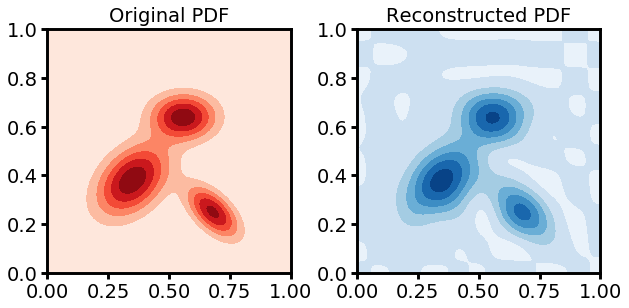
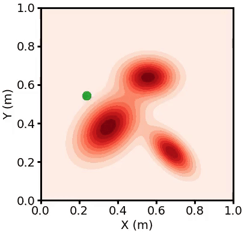
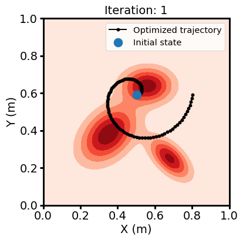
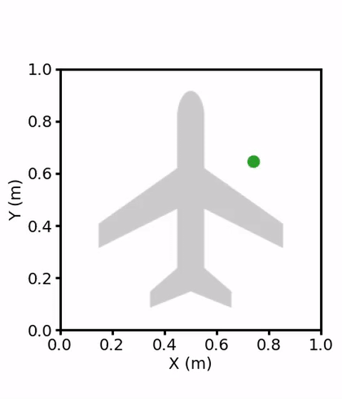
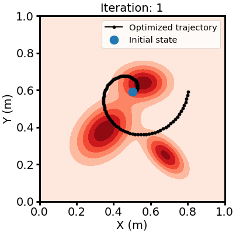

# Ergodic Control Sandbox
<!-- Sandbox code for "Tutorial on Ergodic Control @ ICRA 2024" -->
Standalone tutorials for ergodic control (previously sandbox code for "Tutorial on Ergodic Control at ICRA 2024").

This sandbox accompanies the paper [*Ergodic Control and Controlled Diffusion for Robot Learning: Review and Tutorial*](https://arxiv.org/abs/2609.13295).

Authors: [Max Muchen Sun](https://maxsun.io/), [Cem Bilaloglu](https://sites.google.com/view/cembilaloglu/home)

## Table of contents

| *Tutorial* | *Code* | 
| :---: | :---: |
| **Introduction to Ergodic Metric** <br>  | [[Jupyter Notebook]](notebooks/ergodic_metric.ipynb) <br> [[Google Colab]](https://colab.research.google.com/github/MurpheyLab/ergodic-control-sandbox/blob/main/notebooks/ergodic_metric.ipynb) | 
| **Closed-Form Ergodic Control** <br>  | [[Jupyter Notebook]](notebooks/smc_ergodic_control.ipynb) <br> [[Google Colab]](https://colab.research.google.com/github/MurpheyLab/ergodic-control-sandbox/blob/main/notebooks/smc_ergodic_control.ipynb) | 
| **Trajectory Optimization for Ergodic Control** <br>  | [[Jupyter Notebook]](notebooks/ilqr_ergodic_control.ipynb) <br> [[Google Colab]](https://colab.research.google.com/github/MurpheyLab/ergodic-control-sandbox/blob/main/notebooks/ilqr_ergodic_control.ipynb) |
| **Heat Equation Driven Area Coverage (HEDAC)** <br>  | [[Jupyter Notebook]](notebooks/hedac_ergodic_control.ipynb) <br> [[Google Colab]](https://colab.research.google.com/github/MurpheyLab/ergodic-control-sandbox/blob/main/notebooks/hedac_ergodic_control.ipynb) |
| **Ergodic Control with Kernel Functions** <br>  | [[Jupyter Notebook]](notebooks/kernel_ergodic_control.ipynb) <br> [[Google Colab]](https://colab.research.google.com/github/MurpheyLab/ergodic-control-sandbox/blob/main/notebooks/kernel_ergodic_control.ipynb) |
| **Kernerl Ergodic Search on Lie Groups** <br>  | [[Jupyter Notebook]](notebooks/kernel_ergodic_control_SO3.ipynb) <br> [[Google Colab]](https://colab.research.google.com/github/MurpheyLab/ergodic-control-sandbox/blob/main/notebooks/kernel_ergodic_control_SO3.ipynb) |
| **Ergodic Metric for Point Cloud Registration** <br>  | [[GitHub Repo]](https://github.com/MurpheyLab/FLS) |  


## Copyright and License

The implementations contained herein are copyright (C) 2024 - 2025 by Muchen Sun, and are distributed under the terms of the GNU General Public License (GPL) version 3 (or later). Please see the LICENSE for more information.

## Citation

If you use the sandbox in your research, please cite:

```bibtex
@misc{sun2026ergodiccontrolcontrolleddiffusion,
  title={Ergodic Control and Controlled Diffusion for Robot Learning: Review and Tutorial},
  author={Max Muchen Sun and Cem Bilaloglu and Ananya Rao and Stefan Ivic and Guillaume Sartoretti and Kathleen Fitzsimons and Ian Abraham and Sylvain Calinon and Todd Murphey},
  year={2026},
  eprint={2609.13295},
  archivePrefix={arXiv},
  primaryClass={cs.RO},
  url={https://arxiv.org/abs/2609.13295},
}
```

Contact: Max Muchen Sun ([msun@u.northwestern.edu](msun@u.northwestern.edu))

Lab Info: Prof. Todd D. Murphey, [Interactive & Emergent Autonomy Lab](https://murpheylab.github.io/) / [Center for Robotics and Biosystems](https://robotics.northwestern.edu/) / Northwestern University
